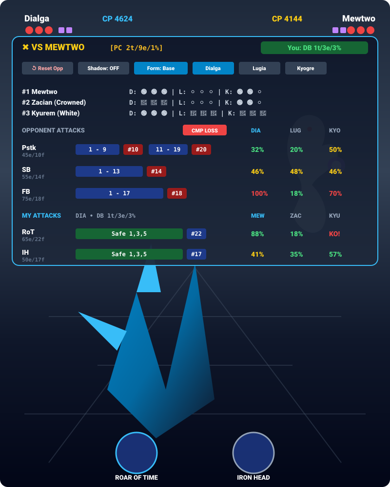
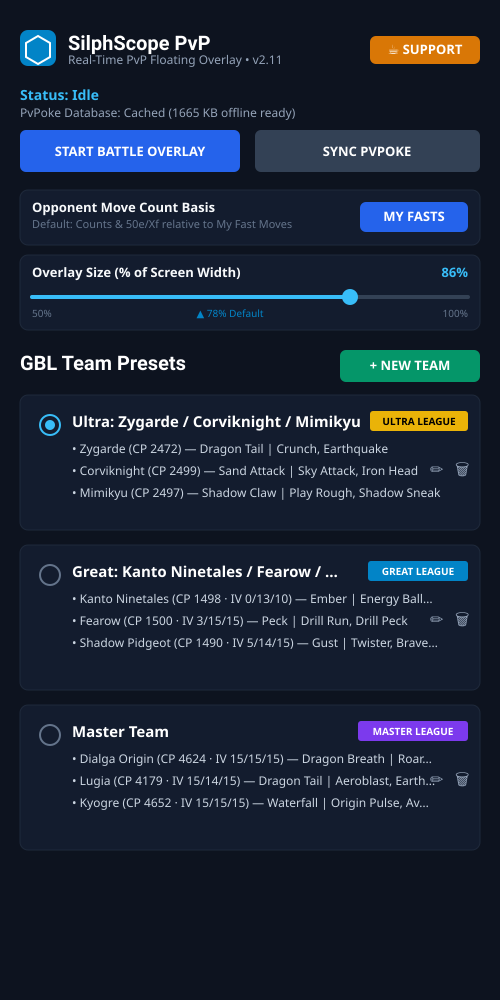
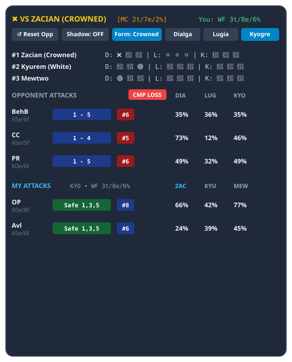
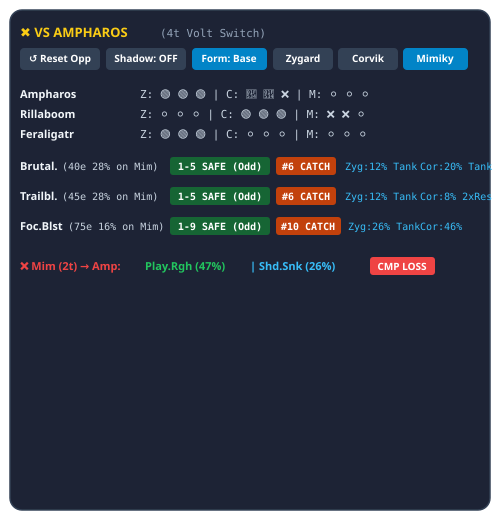

# BattleMatrix GBL - Real-Time 3x3 Matchup Matrix, Damage Calculations & Turn Pacing HUD for Pokémon GO PVP (v1.11)

[](https://sportsfan986.github.io/battlematrix-gbl/)
[](https://buymeacoffee.com/sportsfan986)
[](https://github.com/sportsfan986/battlematrix-gbl/releases)

---



**BattleMatrix GBL** is a standalone Android application and client-side web battle simulator for **Pokémon GO Battle League (GBL)**. Built with Kotlin, WindowManager `TYPE_APPLICATION_OVERLAY`, in-memory `MediaProjection` frame analysis (zero disk writes), PvPoke `gamemaster.json` stats, offline Google ML Kit Text Recognition, and an interactive React web dashboard.

---

## 📸 Real Android Application Screenshots & In-Game HUD

| Main App & Presets Manager | Master League HUD (Kyogre vs Zacian) | Ultra League HUD (Mimikyu vs Ampharos) |
| :---: | :---: | :---: |
|  |  |  |

- **Main App & Presets Manager (Left)**: Floating overlay controller, PvPoke sync status, move count basis toggles, `50%–100%` overlay scaler, and persistent league team presets.
- **Master League In-Game HUD (Center)**: Real-time damage calculations for Kyogre vs Zacian (Crowned), shield scenarios, move energy cycles, and CMP tie alerts.
- **Ultra League In-Game HUD (Right)**: Turn pacing, safe move timing windows, catch point recommendations, and team switch damage previews.

---

## 🎮 Try the Live Web Simulator (No Install Needed)

Experience **BattleMatrix GBL** instantly in your web browser — completely free, client-side, and consuming **0 personal API tokens**:

👉 **[Launch Live Web Simulator — https://sportsfan986.github.io/battlematrix-gbl/](https://sportsfan986.github.io/battlematrix-gbl/)**

- **Explore 3v3 Matchup Matrices**: Compare damage percentages, 0S / 1S / 2S shield scenarios, and CMP tie outcomes for any team.
- **Custom Team Builder**: Pre-populated with the **PvPoke Top 3 rated Pokémon** for Great League, Ultra League, and Master League.
- **Auto-Move Recommendations**: Type any Pokémon name to automatically pre-fill its #1 PvPoke fast and charged moves.
- **Overlay HUD Scaler**: Preview and adjust floating overlay sizes from `50%` to `100%` screen width.

---

## 🖼️ HUD & Feature Overview


---

## ☕ Support Continued Development

If **BattleMatrix GBL** helps you count fast moves, win CMP ties, and climb Elo in GO Battle League, consider supporting continued updates and new feature releases:

👉 **[Buy Me a Coffee — https://buymeacoffee.com/sportsfan986](https://buymeacoffee.com/sportsfan986)**

---

## 📥 Download & Install Native Android APK (v1.11)

1. Visit the **[Official GitHub Releases Page](https://github.com/sportsfan986/battlematrix-gbl/releases)**.
2. Download **`battlematrix-gbl-v1.11.apk`** (or `app-release.apk`) directly to your Android device.
3. Tap the downloaded APK file to install (grant *"Install unknown apps"* permission if prompted).
4. Launch **BattleMatrix GBL**:
   - Select or customize your **GBL Team Presets**, set **Opponent Move Count Basis** (`My Fasts` vs. `Their Fasts`), and adjust **Overlay Size** (`50%–100%` screen width slider).
   - Grant **"Display over other apps"** (Floating Window permission) and **Screen Capture** permission (used strictly in-memory for 1 Hz ML Kit OCR).
   - Tap **"Start Battle Overlay"** and launch Pokémon GO!

---

## ✨ Key Features in v1.11

- **Persistent User Teams & Settings Across App Updates**:
  - Programmed teams, active team selection, move count preferences, and overlay scale persist in a version-independent local store (`gbl_user_teams_persistent`). Updates never overwrite your custom teams!
- **PvPoke Top 3 League Defaults & Custom Templates**:
  - Pre-populated default teams and new team templates automatically default to PvPoke's #1, #2, and #3 rated Pokémon for each league:
    - **Great League**: Clodsire, Shadow Feraligatr, Gastrodon
    - **Ultra League**: Zygarde Complete, Feraligatr, Giratina Altered
    - **Master League**: Palkia Origin, Zacian Crowned, Dialga Origin
- **Auto-Filled Fast & Charged Moves**:
  - Entering a Pokémon name automatically fills in its optimal PvPoke fast move, charged move 1, charged move 2, and league CP limit whenever move/CP fields are left blank.
- **CP-Scaled Stats & Custom IV Calculation**:
  - Calculates true Attack, Defense, and HP stats scaled to the exact league CP cap (`1500` GL, `2500` UL, uncapped ML) using your entered CP and optional `Atk/Def/HP` IVs (auto-defaulting to optimal rank #1 league IVs when left blank) for accurate damage `%`, KO thresholds, and CMP tie determination.
- **3v3 Shield Matchup Matrix & Turn-Aligned Multi-Cycle Move Bars**:
  - Visual segmented move energy bars across all fast move durations (`1t–5t`), 2nd/3rd throw cycles with residual energy tracking, and 3-column incoming/outgoing team damage matrices.
- **Scalable Floating HUD Overlay (50%–100% Screen Width)**:
  - Responsive overlay scaling configured directly in the app settings with smooth proportional font and element scaling.

---

## 🚀 Automated CI/CD & Version Bump Script

Every push to `main` triggers `.github/workflows/android.yml` (builds signed release APK) and `.github/workflows/deploy-pages.yml` (deploys Web Simulator to GitHub Pages).

To increment the version for future releases:
```bash
./scripts/bump_version.sh        # increments sub-version by +0.01 (e.g. v1.10 -> v1.11)
./scripts/bump_version.sh v1.20  # sets an explicit version
```

---

## 💻 Building Locally from Source

1. **Clone the Repository**:
   ```bash
   git clone https://github.com/sportsfan986/battlematrix-gbl.git
   cd battlematrix-gbl
   ```
2. **Build Web Simulator**:
   ```bash
   npm install
   npm run build
   ```
3. **Build Android APK in Android Studio**:
   ```bash
   ./gradlew assembleRelease
   ```
   Output APK location: `app/build/outputs/apk/release/app-release.apk`
