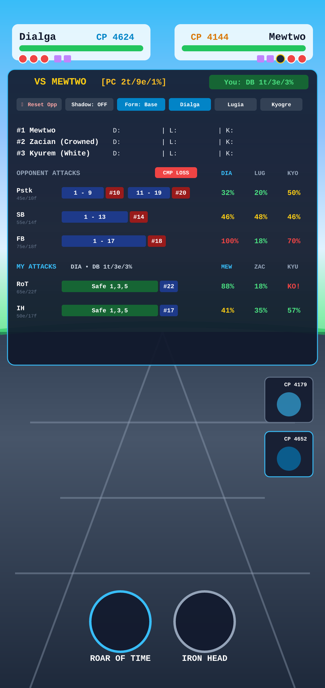
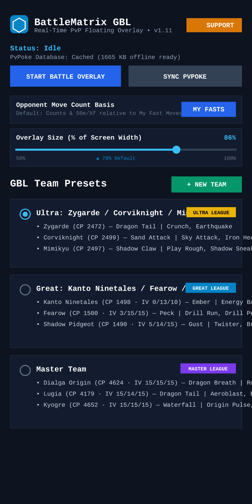
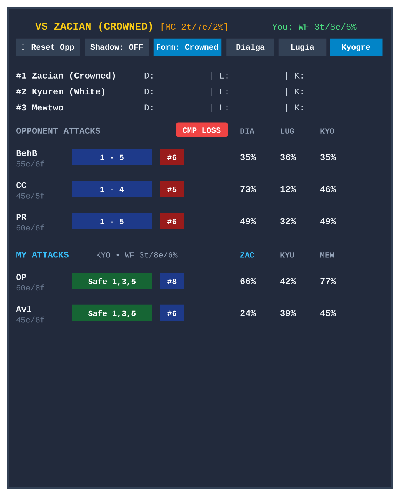
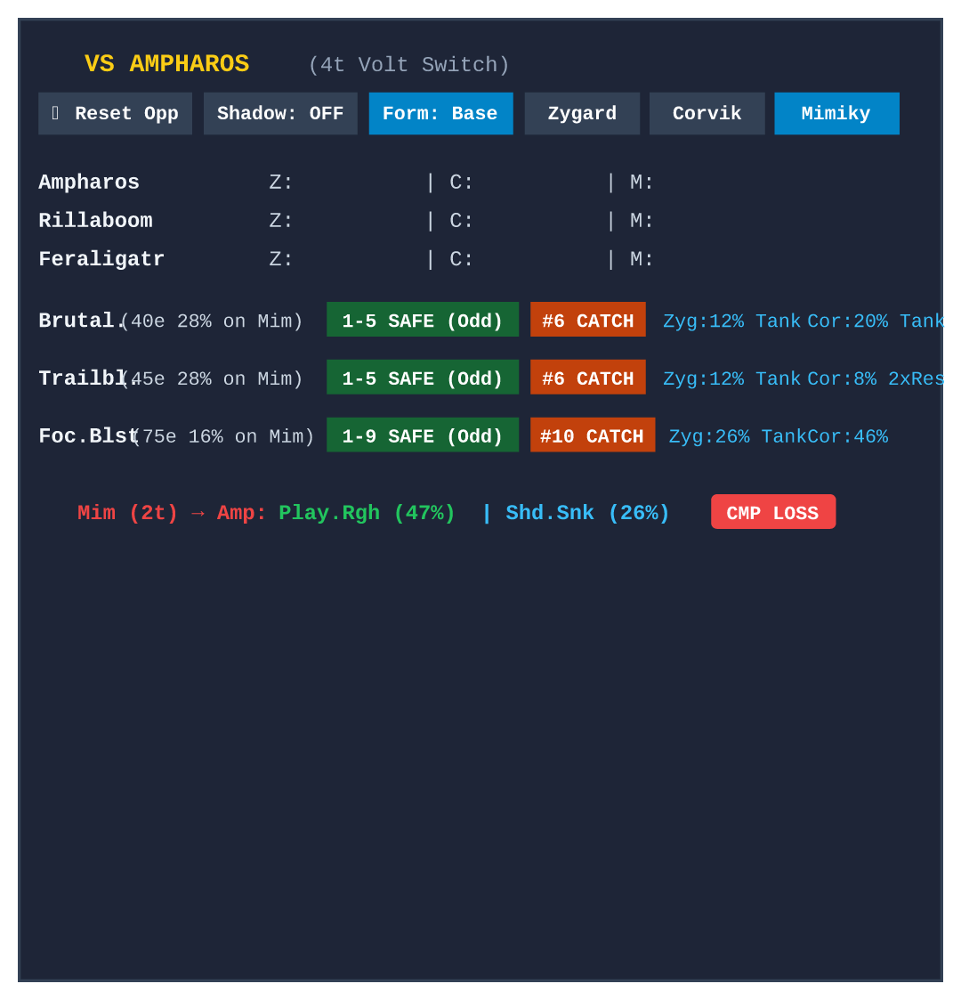
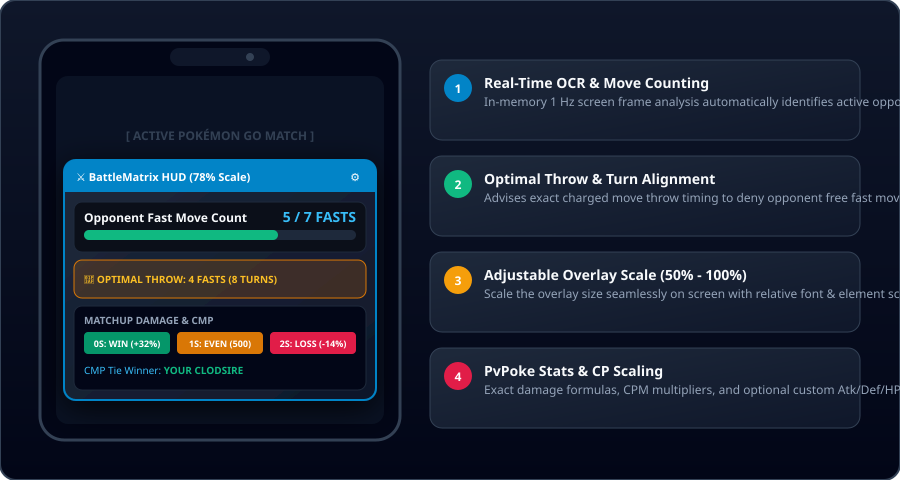

# SilphScope PvP — Real-Time 3x3 Matchup Matrix, Damage Calculations, Turn Pacing HUD & Battle Log Overlay for Pokémon GO PvP (v2.05)

[](https://sportsfan986.github.io/silphscope-pvp/)
[](https://buymeacoffee.com/sportsfan986)
[](https://github.com/sportsfan986/silphscope-pvp/releases)

---



**SilphScope PvP** is a standalone Android application and client-side web battle simulator for **Pokémon GO Battle League (GBL)**. Built with Kotlin, WindowManager `TYPE_APPLICATION_OVERLAY`, in-memory `MediaProjection` frame analysis (zero disk writes), PvPoke `gamemaster.json` + official league rankings JSON synchronization, offline Google ML Kit Text Recognition, multi-device GitHub Cloud Delta Sync, and an interactive React web dashboard.

---

## 📸 Real Android Application Screenshots & In-Game HUD

| Main App & Presets Manager | Master League HUD (Kyogre vs Zacian) | Ultra League HUD (Mimikyu vs Ampharos) |
| :---: | :---: | :---: |
|  |  |  |

- **Main App & Presets Manager (Left)**: Floating overlay controller, PvPoke + Rankings sync status, move count basis toggles, `50%–100%` overlay scaler, background glass transparency slider, and drag-and-drop persistent league team presets.
- **Master League In-Game HUD (Center)**: Real-time damage calculations for Kyogre vs Zacian (Crowned), shield scenarios, move energy cycles, and CMP tie alerts.
- **Ultra League In-Game HUD (Right)**: Turn pacing, safe move timing windows, catch point recommendations, and team switch damage previews.

---

## 🎮 Try the Live Web Simulator (No Install Needed)

Experience **SilphScope PvP** instantly in your web browser — completely free, client-side, and consuming **0 personal API tokens**:

👉 **[Launch Live Web Simulator — https://sportsfan986.github.io/silphscope-pvp/](https://sportsfan986.github.io/silphscope-pvp/)**

- **Explore 3v3 Matchup Matrices**: Compare damage percentages, 0S / 1S / 2S shield scenarios, and CMP tie outcomes for any team.
- **Custom Team Builder with Live Autocomplete**: Pre-populated with the **PvPoke Top 3 rated Pokémon** for Great League, Ultra League, Master League, and Mega Master League. Typing a base Pokémon name automatically surfaces all Base, Shadow, Regional (Alolan/Galarian/Hisuian/Paldean), and Alternate/Mega forms in a live pop-down menu.
- **Official PvPoke Rankings Move Engine**: Synchronizes `gamemaster.json` alongside official PvPoke league rankings JSONs (`1500`, `2500`, `10000`, and `mega/10000`) to automatically assign meta-recommended Fast and Charged moves by usage.
- **Battle Log, Interactive Replay & Go Battle Log Export**: Record wins/losses with automatic lead matchup classification, replay any historical matchup in the interactive matrix, restore deleted battles/teams from the Trash Bin, and export directly in `[My Team]` + `opp1 opp2 opp3 W/L` Go Battle Log format.

---

## 🖼️ HUD & Feature Overview



---

## ☕ Support Continued Development

If **SilphScope PvP** helps you count fast moves, win CMP ties, and climb Elo in GO Battle League, consider supporting continued updates and new feature releases:

👉 **[Buy Me a Coffee — https://buymeacoffee.com/sportsfan986](https://buymeacoffee.com/sportsfan986)**

---

## 📥 Download & Install Native Android APK (v2.05)

1. Visit the **[Official GitHub Releases Page](https://github.com/sportsfan986/silphscope-pvp/releases)**.
2. Download **`silphscope-pvp-v2.05.apk`** directly to your Android device.
3. Tap the downloaded APK file to install (grant *"Install unknown apps"* permission if prompted).
4. Launch **SilphScope PvP**:
   - Select, reorder, or customize your **GBL Team Presets**, set **Opponent Move Count Basis** (`My Fasts` vs. `Their Fasts`), and adjust **Overlay Size** (`50%–100%` screen width slider) and **Background Transparency**.
   - Grant **"Display over other apps"** (Floating Window permission) and **Screen Capture** permission (used strictly in-memory for 1 Hz ML Kit OCR).
   - Tap **"Start Battle Overlay"** and launch Pokémon GO!

---

## ✨ Key Features in v2.05

- **Instant Opponent Reset on `⚔️ Start Battle`**:
  - Pressing `⚔️ Start Battle` immediately resets the opponent list and empties the 3x3 matrix for a new match in a single tap, while preserving a snapshot of the previous opponents so you can still log a Win/Loss from the quick pop-up menu and preventing stale/in-flight OCR frames from re-populating cleared opponents.
- **Battle Menu OCR Guard (`BATTLE` & `PARTY` Filter)**:
  - Blocks menu header tokens (`battle`, `party`, `battles`, `parties`) from fuzzy-matching Pokémon names (such as `Paras`) and automatically pauses OCR scanning when on the Pokémon GO Battle Menu screen.
- **Trash Bin Modal + Quick Undo Toast for Deleted Battles & Teams**:
  - Soft-deletes battle logs and team presets into a persistent Trash Bin with an instant `↩ UNDO` banner and one-tap individual or bulk restoration.
- **Go Battle Log Friendly Export (`[Team]` + `opp1 opp2 opp3 W/L`)**:
  - Copy or share filtered battle logs in Go Battle Log format with bracketed user team headers (`[Pokemon1, Pokemon2, Pokemon3]`) and clean `opp1 opp2 opp3 W/L` rows without date clutter.
- **Multi-Device GitHub Cloud Delta Sync (OAuth Device Flow)**:
  - Sign in directly on Android or Web via GitHub's native Device Flow (`github.com/login/device`) to automatically synchronize team presets and battle logs across multiple phones using conflict-free union + Last-Write-Wins (LWW) + tombstone delta reconciliation.
- **Team Builder Live Pokémon Autocomplete & PvPoke Rankings Sync**:
  - Downloads and caches official PvPoke `gamemaster.json` and league rankings JSON endpoints (`1500`, `2500`, `10000`, and `mega/overall/rankings-10000.json`) for meta-recommended movesets and CP-scaled stats.
- **3v3 Shield Matchup Matrix & Turn-Aligned Multi-Cycle Move Bars**:
  - Visual segmented move energy bars across all fast move durations (`1t–5t`), 2nd/3rd throw cycles with residual energy tracking, and 3-column incoming/outgoing team damage matrices.

---

## 🚀 Automated CI/CD & Version Bump Script

Every push to `main` triggers `.github/workflows/android.yml` (builds signed release APK `silphscope-pvp-vX.XX.apk`) and `.github/workflows/deploy-pages.yml` (deploys Web Simulator to GitHub Pages).

To increment the version for future releases:
```bash
./scripts/bump_version.sh        # increments sub-version by +0.01 (e.g. v2.05 -> v2.06)
./scripts/bump_version.sh v2.05  # sets an explicit version
```

---

## 💻 Building Locally from Source

1. **Clone the Repository**:
   ```bash
   git clone https://github.com/sportsfan986/silphscope-pvp.git
   cd silphscope-pvp
   ```
2. **Build Web Simulator**:
   ```bash
   npm install
   npm run build
   ```
3. **Build Android APK in Android Studio**:
   ```bash
   ./gradlew assembleRelease
   ```
   Output APK location: `app/build/outputs/apk/release/app-release.apk`
